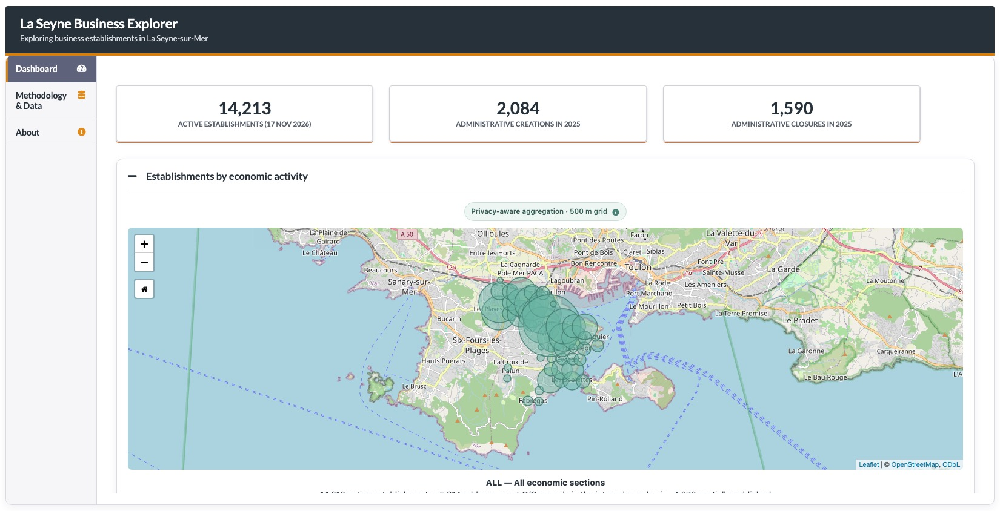
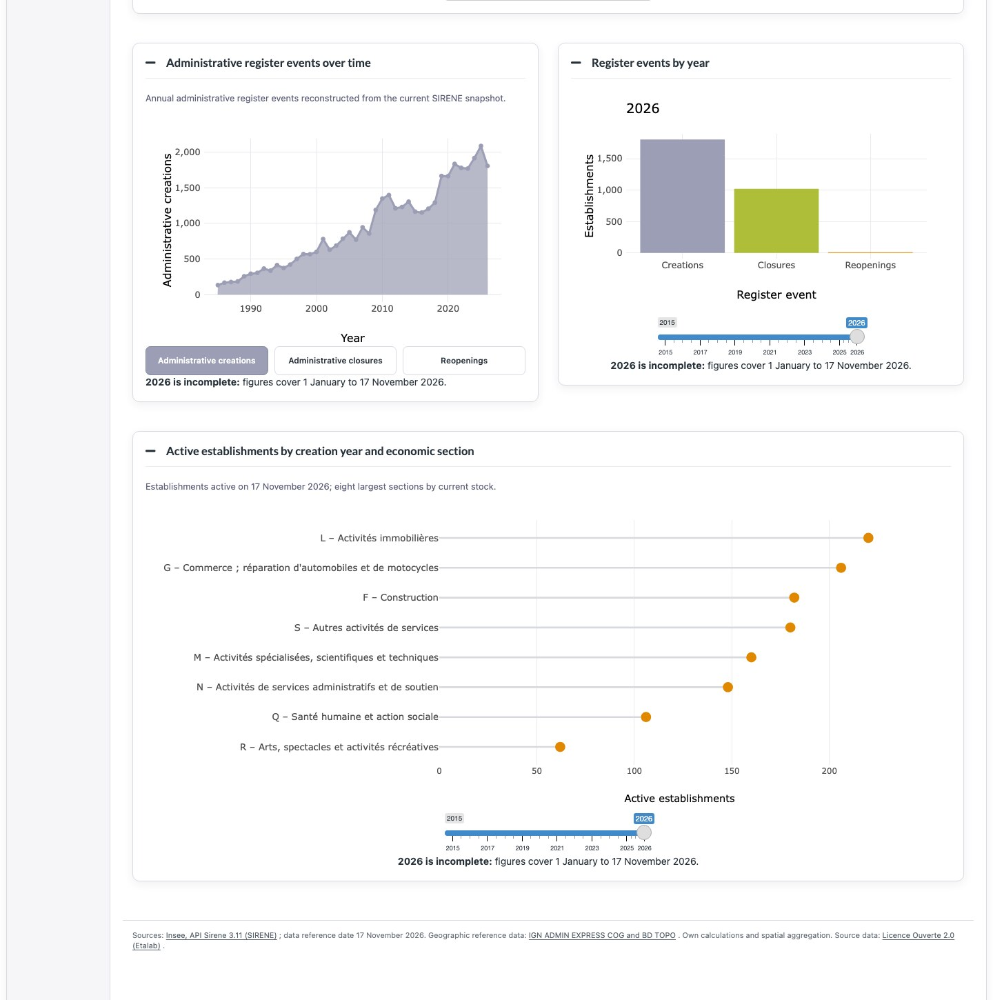
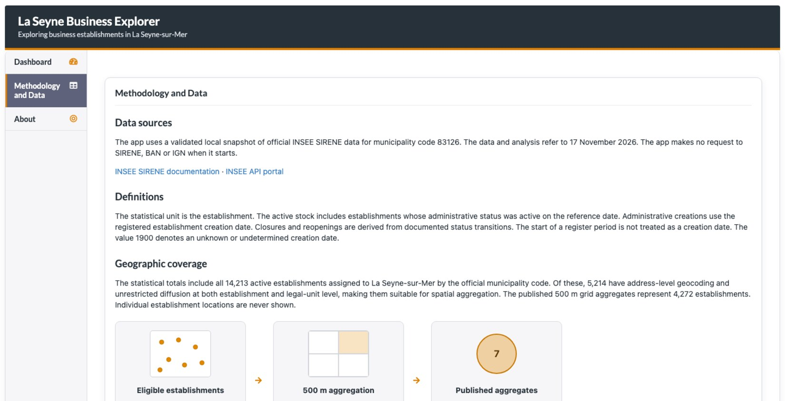

# La Seyne Business Explorer

**Exploring business establishments in La Seyne-sur-Mer**

La Seyne Business Explorer is an R/Shiny portfolio project for exploring the
active establishment stock and administrative register events in
La Seyne-sur-Mer, France. It uses a validated, privacy-filtered local snapshot
derived from the official INSEE SIRENE register.

The application builds on an earlier project developed by the author and was
revised and extended with AI assistance.

## Features

- interactive Leaflet map with proportional circles for privacy-aware 500 m
  aggregates, contextual released-cell outlines at close zoom and a fixed
  home extent;
- filters for 18 official NAF Rev. 2 economic sections;
- aggregate-only pop-ups with economic section and released count;
- current-stock indicators and the unchanged municipality-wide retrospective
  annual register-event views for 1973–2026;
- a year-specific comparison for the eight largest NAF sections, using only
  96 precomputed creation-year/section aggregates for 2015–2026;
- a documented distinction between the complete statistical stock and the
  smaller, privacy-safe mapped subset;
- no live SIRENE, BAN or IGN request when the application starts.

## Screenshots

### Dashboard and aggregate map



### Historical register charts



### Methodology and geocoding-quality flow



## Data reference and sources

The analysis and snapshot reference date is **17 November 2026**. The public
runtime contains only aggregate tables. Statistical totals cover 14,213 active
establishments. The internal spatial-processing basis contains 5,214 address-exact O/O
records; 4,272 are represented in 286 released 500 m cell-section aggregates.
The app uses:

- INSEE SIRENE API 3.11 for establishment register data;
- official NAF Rev. 2 classifications;
- BAN and the IGN Géoplateforme geocoding service for offline address matching;
- IGN ADMIN EXPRESS COG and BD TOPO land/water geometry for deterministic
  coastal display anchors;
- OpenStreetMap tiles in the interactive Leaflet map.

Source attribution and applicable third-party terms are documented in
[`NOTICE.md`](NOTICE.md).

## Methodology and limitations

The primary unit is the establishment. Current stock is based on the
administrative status at the analysis date. Administrative creations use the
registered establishment creation date; period starts are not interpreted as
creation dates. Closures and reopenings are reconstructed from documented
status transitions in the current register snapshot.

Historical figures are retrospective register reconstructions and may change
after later corrections. The 2026 figures cover 1 January through 17 November
and therefore do not represent a complete calendar year. Privacy restrictions,
geocoding quality and the spatial minimum-count rule reduce map coverage; all
non-spatial totals continue to include the full active stock.

Historical register events are published only as municipality-wide annual
totals, without economic-section or geographic breakdown. Seventeen early
closure or reopening values are below five. They are retained because the
series discloses no establishment attribute, section or location and because
an uninterrupted retrospective series is analytically useful. The spatial
`n >= 5` rule is therefore not presented as a universal threshold for every
municipality-wide statistic.

The creation-year chart compares the eight largest economic sections, selected
from the current active stock. Its 96 values describe establishments that are
still active on 17 November 2026; they are not historical totals of all business
creations. Every displayed value is at least 13. The chart has no map, legal-form,
person-type or geocoding dimension. The seven municipality-wide creation cohorts
remain in the stock aggregate but are not combined with the chart table.

The 500 m analysis grid is fixed in Lambert-93 (`EPSG:2154`). Circles normally
use the geometric cell centre. For three coastal cells whose centre lies over
water, the anchor is derived deterministically from the intersection of the
cell with official land geometry; establishment coordinates never determine
the displacement.

At zoom level 15 and above, a very light fill and fine outline identify only
the cells already released by the same `n >= 5` rule. The full analysis grid
and suppressed cells are never drawn. Changing the economic section updates
the aggregate layers without resetting the current viewport.

The spatial table contains only cell-section combinations with at least five
address-exact O/O establishments. Its total view is calculated exclusively from
those released combinations. It contains no uncut cell totals or suppressed
residual categories for individual grid cells. Because section-level
aggregation-basis totals and released counts are public, the total excluded by
the spatial threshold can be derived for an economic section, but not allocated
to its suppressed grid cells. The table contains no SIREN/SIRET, names,
addresses, creation years, detailed NAF codes, legal forms or person types. The
map is privacy-aware aggregation, not a claim of complete anonymity or legal
certification.

See [`docs/methodology.md`](docs/methodology.md) for the complete definitions
and [`docs/old-vs-new.md`](docs/old-vs-new.md) for the migration from the former
OpenDataSoft-based application.

## Requirements

The release candidate is tested with **R 4.4.2**. The intended package
environment is recorded in [`renv.lock`](renv.lock), and restoration has been
validated in the isolated Docker environment described below. Direct runtime
packages are:

- `shiny`, `semantic.dashboard` and `leaflet`;
- `plotly`, `ggplot2` and `scales`;
- `htmltools` and `htmlwidgets`.

`testthat` is required only to run the tests. Pipeline scripts have additional
dependencies documented by the lockfile and are not loaded by the public app.
Only `R/app_runtime.R` resides in Shiny's automatic `R/` load directory.
Reproduction and validation helpers live under
`pipeline/`, so local development and the allowlisted deployment use the same
runtime function set.

## Installation and start

Install `renv`, restore the recorded environment and start the app from the
project directory:

```r
install.packages("renv")
renv::restore()
shiny::runApp(".")
```

The app loads only `stock_aggregates.rds`, `spatial_aggregates.rds`, the
byte-identical existing `history_yearly.rds` and the approved 96-row
`creation_year_top8.rds` extension from the publication-safe bundle in
`data/app/insee_2026-11-17_grid500_privacy_v6_simplified/`. It does not require internal raw,
processed, reference or geocoding-cache directories.

## Tests

Run the public test suite from the project directory:

```r
testthat::test_dir("tests/testthat")
```

The public tests cover runtime-data loading, fixed stock and aggregate totals,
NAF sections, creation cohorts, the Top-8 creation-year table and plot payload,
aggregate pop-ups, Sankey reconciliation,
spatial suppression, annual controls and app construction. Internal reproduction and review tests remain local
and are not part of the public repository.

## Reproducibility

The repository distinguishes three layers:

1. the public app and its data-minimised immutable runtime snapshot;
2. selected, documented pipeline components that require a separately
   configured `INSEE_API_KEY` and non-published source/reference data;
3. internal raw responses, full snapshots, geocoding caches and review tables,
   which are intentionally excluded.

Public schemas are validated independently for stock and creation-cohort
aggregates, the 96-row Top-8 creation-year table, spatial aggregates and the
annual total-register history. Internal establishment-row validation is part of the pipeline
and is not sourced when the app starts.

The repository is sufficient to run and test the app with the supplied
aggregates. It is not a self-contained end-to-end reproduction package for the
published aggregates: a full refresh also requires official source/reference
data, internal geocoding and land-geometry inputs, and reviewed preparation
steps that are deliberately excluded from the public repository. The public app
never refreshes its data automatically. A new reference date requires an
explicit authenticated pipeline run, validation and creation of a new
versioned public snapshot.

The public tree from commit `c5ce35119c6ac92c5d2fb182da956078346c7c07` was
validated in a clean `rocker/r-ver:4.4.2` Docker environment on Linux/aarch64.
`renv::restore()` completed successfully and all 120 lockfile package versions
were confirmed. All 278 public tests passed, the app returned HTTP 200, and a
final offline server start succeeded. The container used no host mounts and
required no internal data. This validates installation and execution
of the supplied public aggregates; it does not reproduce the separate internal
INSEE extraction, establishment-level processing, geocoding or spatial build.

## Live application

[Previous shinyapps.io deployment](https://marleen-dettmann.shinyapps.io/LaSeyne_Entreprises/)
— this URL may still show the earlier public version until the present release
candidate has passed review and is deployed.

## License and rights

The original R/Shiny code and project documentation are available under the
[MIT License](LICENSE). The MIT license does not cover the derived app data,
third-party source data, map material or personal author logo. See
[`NOTICE.md`](NOTICE.md) for the applicable sources, attribution and exclusions.

## Author

**Dr. Marleen Dettmann**<br>
Demographer and data analyst<br>
<https://marleen-dettmann.de/>
